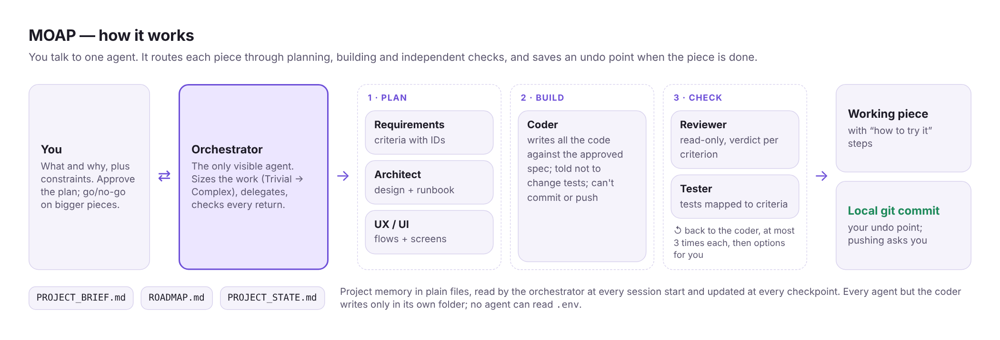

<p align="center"></p>

<h1 align="center">MOAP</h1>

<p align="center">
  <a href="https://github.com/khubli/moap/actions/workflows/test.yml"></a>
  <a href="LICENSE"></a>
</p>

**A ready-made software team for OpenCode that you direct by saying what you want, not how to build it.**

MOAP (Mother Of All Projects) is a template you copy into a new, empty folder. It gives [OpenCode](https://opencode.ai) one agent you talk to and seven specialists behind it that write specs, design, code, review and test, with permissions that keep each of them in its lane. You describe the outcome; you approve a plan; you get working pieces with tests, plain "how to try it" steps and a saved undo point for each.

**[Set it up](docs/setup.md)** in about 15 minutes · **[How it works](docs/how-it-works.md)** · **[Example first message](examples/first-message.md)**

## Why MOAP

Most agent setups give one model a long prompt and full access, and leave you to write the plan and check the result. MOAP starts from how a small delivery team works, and enforces it.

- **You state what and why; the swarm decides how.** You never write prompts, specs or architecture. The orchestrator drafts the brief and the roadmap from your description, and asks you only for decisions that are yours, each with a recommended answer.
- **The process scales to the work.** Every request is sized as Trivial, Small, Standard or Complex before anything starts. A typo goes straight to the coder; a new feature gets a spec, a design and your go/no-go. A level only ever goes up.
- **The author never grades its own work.** The coder is told not to change existing tests, and can't commit or push. The reviewer is read-only and never runs the code. The tester can edit only `tests/`. Fix cycles stop after 3 and come back to you as options, not as an endless loop or a raw error.
- **One thread from requirement to test.** Every acceptance criterion gets an ID. The coder reports coverage against it, the reviewer gives a verdict on each one, the tester maps a test to each one, and a piece isn't done until all three agree.
- **Rules enforced by OpenCode, not just written in prompts.** Every agent except the coder can edit only its own folder. No agent can read `.env`. Pushing asks you; rewriting history and deleting files are blocked. The seven specialists are hidden and can't delegate, so all work routes through one place.
- **Files are the memory.** The brief, the roadmap and a state file are read at the start of every session and updated at every checkpoint, so a new session picks up without you re-explaining anything.
- **Model choice in one place.** All 8 agent files take their model from `opencode.json`, grouped into three tiers by what the role needs. Swapping a model never touches an agent's behaviour.
- **Its own claims are checked.** `scripts/verify-claims.mjs` tests 21 statements this README and the docs make (the roster, the permissions shape, the model block, nothing private in the tree) on every push.

**What it is not:** an app, a framework or a hosted service. It is a set of plain Markdown and JSON files, and it can't make a weak coding model reliable; put your strongest model on the coder.

**Who it's for:** people who want to direct software projects with AI agents and keep the checks a good team would have, whether or not they write code day to day.

## How it works

<picture>
  <source media="(prefers-color-scheme: dark)" srcset="docs/images/how-it-works-dark.png" />
  
</picture>

The orchestrator is the only agent you talk to. It plans with requirements, the architect and UX/UI; hands the approved design to the coder; and accepts a piece only after the reviewer and tester agree against the same acceptance criteria. Details per stage in [docs/how-it-works.md](docs/how-it-works.md).

## How you use it

1. Download MOAP as a ZIP into a new folder and keep the template files ([setup, step 1](docs/setup.md#1-make-a-clean-copy)).
2. Pick a model per tier in `opencode.json`, the only file you edit.
3. Open the folder in OpenCode and say what you want to build:

> *"I want a household budget app for the Contoso family. It reads a monthly CSV export from Woodgrove Bank, groups spending by category, and shows this month against last month. Self-hosted, works offline, no paid APIs."*

The orchestrator writes the brief and the roadmap, asks you to approve them, and builds one piece at a time.

## Documentation

- [Set up a project](docs/setup.md): from nothing to your first session, and three things that switch MOAP off
- [How it works](docs/how-it-works.md): each stage, the definition of done, and the safety rules
- [Configuration](docs/configuration.md): every setting, what each agent may do, process levels, files the swarm writes, adding a specialist
- [AGENTS.md](AGENTS.md): the operating rules every agent follows
- [CHANGELOG](CHANGELOG.md) · [Contributing](CONTRIBUTING.md) · [Security](SECURITY.md)

## Commands

```sh
node scripts/verify-claims.mjs   # check the docs against the files (Node 18+)
```

## Contributing

Improvements to the roles, the gates and the docs are welcome. Read [CONTRIBUTING.md](CONTRIBUTING.md) first: every change to the agents keeps the claims check green.

## How MOAP was built

Krishna Tej Hubli designed and directed MOAP: the problem, the requirements and constraints (a person who is not a day-to-day programmer must be able to direct it, every rule must be checkable, and the template must stay untouched per project), the roster and its permissions, the process levels and the review gates. The prompts, configuration, checks and docs were written by [Claude Code](https://claude.com/claude-code), Anthropic's coding agent, working from that direction, and reviewed against OpenCode's permission rules in repeated rounds. Every change was reviewed before it was merged, and Claude is credited on every commit.

## License

[MIT](LICENSE). © 2026 Krishna Tej Hubli.
