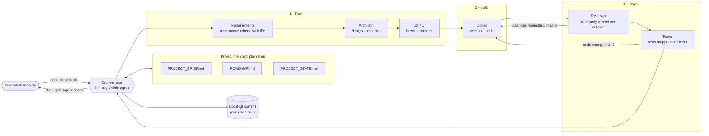

# How MOAP works

Every arrow between agents passes through the orchestrator: specialists cannot call each other (`task: deny`). The diagram shows the order of work, not direct hand-offs.

## You

You say what you want and why, plus anything the swarm cannot guess: a budget, a platform, a deadline, a rule of your domain. You approve the brief and the roadmap at the start, give a go/no-go on each Standard or Complex piece, and push to GitHub when you want an off-machine copy. Nothing else is asked of you, and every question comes with a recommended answer.

## Orchestrator

The only agent you talk to. It reads the brief, roadmap and state file at the start of every session, picks a process level for the request (Trivial, Small, Standard or Complex), and says which before it starts. It writes each delegation in a fixed shape (goal, files to read, constraints, deliverable, the bar for a usable return) and checks every return against it before passing it on. It cannot edit code; it can edit only the three project-memory files.

## 1 · Plan

- **Requirements** turns the request into a spec with acceptance criteria, each with a stable ID such as `AC-3`, marked Must or Should.
- **Architect** is used when a structural decision is involved. It writes the design for the task and maintains `docs/RUNBOOK.md`: the stack, the layout, and one command each to install, run and test.
- **UX and UI** are used when the piece has a user interface.

Each of them can write only in its own folder under `docs/`, so none of them can change the brief, the roadmap or another's work.

## 2 · Build

The **coder** writes all the code against the approved spec and design, and reports which acceptance criteria it covered. Its prompt tells it not to change existing tests; its permissions block reading `.env`, committing, pushing and deploying.

## 3 · Check

- **Reviewer** is read-only and never runs the code. It returns Pass or Changes requested, with a verdict for every acceptance criterion.
- **Tester** writes and runs tests mapped to the criterion IDs and may edit only `tests/`. When a test fails it says, with evidence, whether the code or the test is wrong.

A piece is done when every Must criterion has not been failed by the reviewer and has a passing test, the app runs with the runbook's single command, you have plain "how to try it" steps, and the state files are updated. Review and test fix cycles are capped at 3 each; after that the orchestrator stops and brings you options (accept with known issues, cut scope, or try another approach) instead of looping.

## Saving

After each finished piece the orchestrator updates the state files first, then makes one local git commit. That commit is your undo point. Pushing is always your action: the orchestrator asks, and reminds you that a push is the only copy that survives a lost laptop.

## Privacy and safety

- No agent can read `.env`, and git ignores it. `.env.example` lists key names only.
- History rewrites, force-adds and file deletion are blocked for the orchestrator; the coder and tester cannot stage, commit, push or deploy.
- Terminal rules match command text, so they are a safety net rather than a sandbox. Each agent's prompt carries the same rules.
- Running OpenCode with `--auto`, switching to the built-in `build` agent, or typing a specialist's name yourself bypasses these gates. See [setup](setup.md#three-things-that-switch-moap-off).
